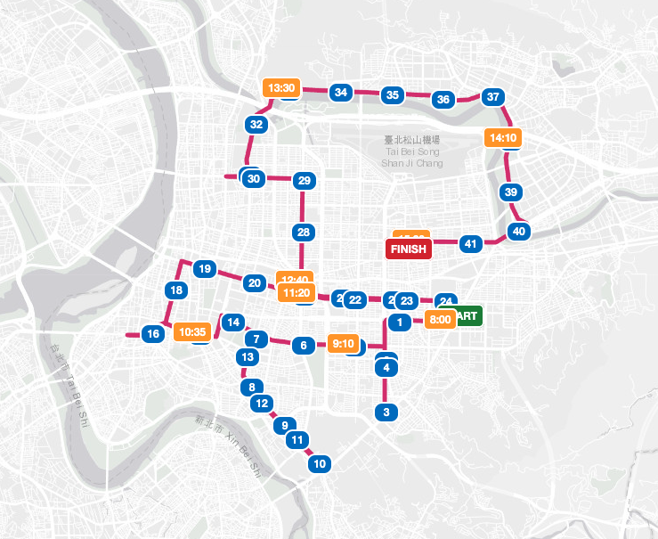

# 台北馬拉松路線優化｜Taipei Marathon Route Optimization

> 市長你給我聽好了：台北馬拉松路線優化 — 以台北市開放資料，重新設計一條對市民衝擊更小、更適合市民應援的路線。



## 直接觀看
- 互動報告：https://abujiuhaobb.github.io/Taipei_debugthon_TaipeiMarathon/
- 現行路線地圖：https://abujiuhaobb.github.io/Taipei_debugthon_TaipeiMarathon/Taipei_42K_current_route.html
- 優化路線地圖：https://abujiuhaobb.github.io/Taipei_debugthon_TaipeiMarathon/Taipei_42K_future_route.html

## 專案簡介
台北馬拉松每年 12 月舉辦，現行路線一半在市區、一半在高架與河濱。市區段封路對市民通勤衝擊大，且因起跑過早（6:30），市民難以參與應援；後段河濱／高架則對跑者負擔大、缺乏應援。

本專案以台北市開放資料（捷運出入口、人行地下道、人行天橋、高架與車行地下道、醫院、消防隊、警察局）盤點沿線穿越與緊急設施，提出「前段 27km 精華區＋中段 6km＋後段 9km」的優化路線（共 42km），並以關門時間逐步開放賽道，降低封路對城市生活的影響。

## 主要成果
- 人行穿越覆蓋大幅提升：現行路線無替代穿越點約 69%，優化路線降到約 39%（100m 內設施 35→140 座、250m 內 78→161 座、500m 內 175→200 座）。
- 市民應援：優化路線大多位於精華區，經過 15 個捷運站，預期更多市民可到現場應援。
- 緊急設施：優化路線貼近 5 個消防＋13 個醫院（現行 3＋9），封路時需預留車道。
- 起跑時間：建議由 6:30 改為 8:00（台北緯度較東京、首爾低，太晚起跑溫度過高）。
- 關門時間：參考東京馬拉松，依時間點逐步開放賽道（9:10～15:00）。

## 專案結構
```
index.html                     互動報告與底部浮動地圖
data.js                        地圖資料（GeoJSON 變數）
image/                         報告與地圖示意圖
Taipei_42K_current_route.html  現行路線地圖
Taipei_42K_future_route.html   優化路線地圖
processed/                      處理後的地理資料（GeoJSON／CSV）
raw_data/                       台北市開放資料原始檔
```

## 資料來源
台北市政府開放資料平台：捷運出入口、人行地下道、人行天橋、高架道路與車行地下道、醫院、消防隊、警察局，以及台北馬拉松現行路線（GPX）。座標系統 TWD97（Big5），已轉 WGS84 供地圖呈現。

## 授權
本作品以 **CC BY-ND 4.0**（Creative Commons Attribution-NoDerivatives 4.0 International）授權，詳見 [LICENSE](LICENSE)。引用請註明作者。

## 貢獻
歡迎 Issue／Pull Request 指正資料或路線建議。
